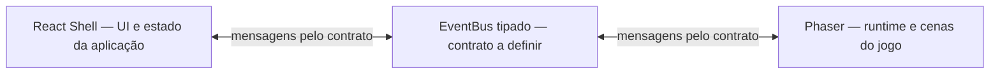

# Chronics of Lunara — GDD Parcial

> **Status:** Parcial — Discovery em andamento; não é o GDD final aprovado.  
> **Fase registrada:** Fase 1/8 — Blocos A–C concluídos; Bloco D iniciado, respostas pendentes.  
> **Versão:** 0.1  
> **Data:** 11/11/2026  
> **Idioma:** Português (Brasil)  
> **Framework:** GDD-MODEL-IA v1.0.0

## Escopo deste snapshot

Este documento registra somente as decisões e direções aceitas até o ponto atual da entrevista. O Bloco D foi apresentado, mas ainda não respondido. Itens não decididos estão marcados como **[PENDENTE]**; requisitos do template que precisam ser tratados no GDD final estão identificados como requisitos do framework, não como decisões já aprovadas de implementação.

**Gate de aprovação:** este arquivo não substitui o Game Brief de 1 página. O GDD completo só será redigido após concluir o Discovery, preparar o Game Brief e receber aprovação explícita do usuário, conforme o processo combinado.

## Histórico de versões

| Versão | Data | Alterações |
|---|---|---|
| 0.1 | 11/11/2026 | Snapshot parcial do Discovery: visão, público, modelo comercial e direção técnica aceitos; Gameplay e demais blocos ainda em aberto. |

## Sumário

1. [Visão Geral](#1-visão-geral)
2. [Gameplay](#2-gameplay)
3. [Conteúdo do Jogo](#3-conteúdo-do-jogo)
4. [Interface e Experiência (UX/UI)](#4-interface-e-experiência-uxui)
5. [Arte e Direção Visual](#5-arte-e-direção-visual)
6. [Áudio](#6-áudio)
7. [Arquitetura Técnica (React + Phaser)](#7-arquitetura-técnica-react--phaser)
8. [Monetização e Live Ops](#8-monetização-e-live-ops)
9. [Produção e Gestão](#9-produção-e-gestão)
10. [Qualidade, Testes e Lançamento](#10-qualidade-testes-e-lançamento)
11. [Requisitos Consolidados](#11-requisitos-consolidados)
12. [Premissas, Riscos Abertos e Perguntas Pendentes](#12-premissas-riscos-abertos-e-perguntas-pendentes)
13. [Apêndices](#13-apêndices)

---

## 1. Visão Geral

### 1.1 Elevator Pitch

Lunara, uma garota de vida comum, é teleportada para outro mundo e conhece o Hat of Eternity, um chapéu mágico senciente que a acompanha, oferece dicas diegéticas para puzzles e sabe que vive dentro de um jogo. Uma aventura Puzzle-RPG top-down 3/4 com humor ácido e temas existenciais.

### 1.2 Conceito

A pessoa jogadora controla Lunara, que é subitamente teleportada de sua vida normal para outro mundo. Lá, ela conhece o **Hat of Eternity**, um chapéu mágico senciente que permanece com ela durante a aventura, ajuda com puzzles e tem consciência de que está dentro de um jogo. O conceito combina fantasia de portal, puzzles e elementos de RPG; o foco maior é em puzzles.

### 1.3 Gênero, plataforma e público

| Aspecto | Direção confirmada |
|---|---|
| Gênero | Puzzle-RPG, com maior foco em puzzle. |
| Câmera | Top-down 3/4; referência de câmera/estilo indicada: *OneShot*. |
| Público-alvo | 13–20 anos, com foco em fãs de jogos indie narrativos, puzzle e RPG. |
| ClassInd escolhida | 14+. |
| Demo | Gratuita, jogável no navegador; inclui o Capítulo 1; distribuição prevista via itch.io. |
| Jogo completo | Premium; distribuição prevista via itch.io e/ou Steam, com wrapper desktop Tauri ou Electron. A tecnologia de wrapper ainda não foi escolhida. |
| MVP | Sem versão mobile no MVP, conforme direção técnica aceita. |

### 1.4 Pilares

**[PENDENTE]** A lista formal de 3–5 pilares ainda não foi aprovada. Elementos confirmados que podem fundamentar essa lista são: foco em puzzles; presença contínua e diegética do Hat of Eternity como sistema de dicas; consciência do Hat de que está em um jogo; e combinação de humor ácido com temas psicológicos e existenciais. Isso ainda não constitui uma lista final de pilares.

### 1.5 USP

O **Hat of Eternity** acompanha Lunara durante toda a aventura, funciona como sistema diegético de dicas para puzzles e quebra a quarta parede, tendo plena consciência de que está dentro de um jogo.

### 1.6 Referências e diferenciação

- **Referência confirmada:** *OneShot* para a perspectiva/câmera top-down 3/4.
- A referência não confirma, por si só, adoção de arte pixel art, sistemas, narrativa ou mecânicas específicas de *OneShot*.
- **[PENDENTE]** Outras referências e a diferenciação comparativa serão definidas no Discovery.

### 1.7 Experiência-alvo

**[PENDENTE]** Ritmo, duração de sessões, intensidade emocional, ritmo de dicas e experiência desejada ao longo de uma sessão ainda não foram definidos.

### 1.8 ClassInd e justificativa

- **ClassInd indicada:** 14+.
- **Justificativa registrada na entrevista:** combinação de humor ácido do Hat of Eternity com temas psicológicos e existenciais.
- **[PENDENTE]** A validação final da classificação dependerá do conteúdo completo, incluindo cenas, diálogos, temas e representação de violência ou outros conteúdos, caso existam.

### 1.9 Escopo MoSCoW

O modelo comercial e a divisão entre demo e jogo completo estão confirmados. A priorização formal MoSCoW de funcionalidades será feita na Fase 5.

| Item de escopo confirmado | Situação |
|---|---|
| Demo gratuita para navegador com o Capítulo 1 jogável | Direção de produto confirmada. |
| Jogo completo Premium | Direção de produto confirmada. |
| Versão mobile no MVP | Fora do MVP, conforme recomendação técnica aceita. |
| Priorização Must/Should/Could/Won’t de funcionalidades e conteúdo | **[PENDENTE]** Fase 5 — backlog. |

## 2. Gameplay

### 2.1 Core Loop

**[PENDENTE]** A sequência micro, macro e meta do core loop não foi definida. Sabe-se que o jogo é um Puzzle-RPG com foco em puzzles e que o Hat ajuda com dicas; ordem de exploração, interação, resolução, recompensa e progressão ainda precisa ser respondida no Bloco D. O diagrama Mermaid será elaborado após essa definição.

### 2.2 Mecânicas

Os IDs abaixo são provisórios para rastreabilidade; os detalhes de implementação e critérios de aceite dependem das respostas de Gameplay.

| ID | Mecânica | Entrada | Regras conhecidas / pendentes | Feedback | Critério de aceite |
|---|---|---|---|---|---|
| MEC-001 | Resolução de puzzles | **[PENDENTE]** | O jogo prioriza puzzles; tipos, regras, falha, reset e progressão dos puzzles não foram definidos. | **[PENDENTE]** | **[PENDENTE]** |
| MEC-002 | Dicas diegéticas do Hat of Eternity | **[PENDENTE]** | Confirmado que o Hat funciona como sistema de dicas para puzzles. Forma de solicitação, quantidade/níveis de dica, custo e consequências narrativas estão pendentes. | **[PENDENTE]** | **[PENDENTE]** |
| MEC-003 | Consciência da quarta parede / interação meta | **[PENDENTE]** | Confirmado que o Hat sabe estar dentro de um jogo e quebra a quarta parede. Interações concretas com menus, configurações, arquivos, memória ou elementos fora do canvas não foram definidas. | **[PENDENTE]** | **[PENDENTE]** |

### 2.3 Controles e mapeamento

- **Dispositivos aceitos como alvo:** teclado, mouse e gamepad.
- **[PENDENTE]** Mapeamento de ações, navegação de menus, remapeamento e comportamento por dispositivo.

### 2.4 Câmera

Câmera top-down 3/4, com *OneShot* como referência indicada. Resolução de mundo, escala, enquadramento, limites e comportamento em transições são **[PENDENTE]**.

### 2.5 Física e colisões

**[PENDENTE]** Velocidade, colisores, interação com cenário, bloqueios, física e regras de colisão.

### 2.6 Vitória, derrota, continue e respawn

**[PENDENTE]** Condições de vitória, falha, Game Over, reset de sala, continue, respawn e consequências de escolhas não foram definidas. A existência de combate, morte ou múltiplos finais ainda não está confirmada.

### 2.7 Progressão

**[PENDENTE]** Estrutura linear ou com hubs, regiões, capítulos após o Capítulo 1, desbloqueios e progressão de personagem.

### 2.8 Economia

**[PENDENTE]** Moeda, recursos consumíveis, loja, colecionáveis e economia interna. O modelo Premium da distribuição não define, por si só, a existência de economia dentro do jogo.

### 2.9 Dificuldade, curva e onboarding

**[PENDENTE]** Curva de dificuldade, acessibilidade dos puzzles, tutorial e onboarding de 60–90 segundos.

### 2.10 Sistemas de suporte

O sistema de dicas do Hat está confirmado como conceito; seu fluxo ainda está pendente (MEC-002). Outros sistemas de suporte, como registro de objetivos, diário, mapa, opções de acessibilidade e ajuda contextual, ainda não foram definidos.

### 2.11 Balanceamento

Não há parâmetros ou valores de balanceamento confirmados. Para evitar números inventados, a tabela final `Parâmetro | Padrão | Mín | Máx | Unidade | Obs` será preenchida após definição das mecânicas, dificuldade e ritmo.

## 3. Conteúdo do Jogo

### 3.1 Personagens jogáveis

| ID provisório | Personagem | Informação confirmada | Informação pendente |
|---|---|---|---|
| ENT-001 | Lunara | Protagonista controlada pela pessoa jogadora; garota que vivia uma vida normal antes de ser teleportada para outro mundo. | Idade da personagem, aparência, atributos, habilidades, voz e arco completo. |

### 3.2 Inimigos, NPCs e chefes

- **ENT-002 — Hat of Eternity:** chapéu mágico senciente que acompanha Lunara durante a aventura, auxilia com dicas de puzzles e tem consciência de estar dentro de um jogo.
- **[PENDENTE]** Outros NPCs, inimigos, chefes, combate e máquinas de estados (FSM). Não está confirmado se haverá inimigos ou chefes.

### 3.3 Itens e coletáveis

**[PENDENTE]** Inventário, itens-chave, consumíveis, colecionáveis e quaisquer IDs `ITM-###` serão definidos após a decisão sobre mecânicas e economia.

### 3.4 Níveis e fases

- A demo gratuita deverá incluir o **Capítulo 1 jogável**.
- **[PENDENTE]** Quantidade e nomes de níveis (`LVL-##`), mapas, cenas, duração, checkpoints e conteúdo posterior ao Capítulo 1.

### 3.5 Level design, teaching moments e Tiled

- **Ferramenta/formato de mapa aceito como direção técnica:** Tiled, arquivos `.tmj`.
- **[PENDENTE]** Estrutura de salas, regras de navegação, sequência de ensino de mecânicas, teaching moments, checkpoints e critérios de conclusão de fase.

### 3.6 Narrativa, personagens e diálogos

**Premissa confirmada:** Lunara vivia uma vida normal até ser teleportada repentinamente para outro mundo, onde conhece o Hat of Eternity. O tom combina humor ácido do Hat com temas psicológicos e existenciais. O Hat é autoconsciente de que está dentro de um jogo.

**[PENDENTE]** Sinopse completa, estrutura de capítulos, conflitos, elenco adicional, escolhas, diálogos, finais, cronologia e limites da quebra da quarta parede.

## 4. Interface e Experiência (UX/UI)

### 4.1 Fluxo de telas

**[PENDENTE]** Fluxo de telas e estados ainda não especificado. O template do GDD exige avaliar Boot, Preload, Menu, Jogo, Pausa, Game Over e Créditos; a presença e as regras de cada tela — especialmente Game Over — não estão confirmadas neste ponto.

### 4.2 Wireframes textuais

**[PENDENTE]** Wireframes de menu, HUD, inventário, diálogo, pausa, configurações e demais telas.

### 4.3 HUD

**[PENDENTE]** Elementos de HUD, estados contextuais, legibilidade e comportamento em gameplay.

### 4.4 Menus e configurações

**[PENDENTE]** Estrutura dos menus, configurações, acessibilidade, idioma, áudio e remapeamento. A relação dessas telas com a meta-narrativa do Hat também não foi definida.

### 4.5 Juice

**[PENDENTE]** Transições, animações de interface, partículas, vibração, feedback de interação e efeitos de resposta a puzzles.

### 4.6 Acessibilidade

O template do GDD requer tratar WCAG 2.2, contraste mínimo de 4.5:1, remapeamento, opções para daltonismo, reduced motion, legendas e fotossensibilidade (incluindo avaliação de estímulos acima de 3 flashes/s). Esses pontos ainda precisam virar especificações, critérios verificáveis e testes para o jogo.

### 4.7 Internacionalização

O GDD final deve prever expansão de texto de pelo menos 30% e documentar i18n. **[PENDENTE]** Idiomas de lançamento, fontes, regras de layout, localização de imagens e processo de tradução.

## 5. Arte e Direção Visual

### 5.1 Estilo e moodboard

- Referência confirmada para câmera/perspectiva: top-down 3/4 estilo *OneShot*.
- A referência não confirma um estilo de arte específico.
- **[PENDENTE]** Direção visual, técnica de ilustração, moodboard, nível de detalhe, proporções e identidade visual.

### 5.2 Paleta e tipografia

**[PENDENTE]** Cores em HEX, tipografias, licenças, hierarquia visual e fontes alternativas.

### 5.3 Especificações visuais

**[PENDENTE]** Resolução-base, tamanho de tiles e sprites, FPS de animação, formatos finais, atlas e compressão.

### 5.4 Tabela de assets visuais

Nenhum asset visual específico foi selecionado ou aprovado. O inventário `AST-###` será criado após definir estilo e escopo de conteúdo.

### 5.5 Animações e VFX

**[PENDENTE]** Lista de animações de personagem, efeitos de ambiente, VFX de puzzle, estados e limites de flashes/movimento.

### 5.6 Convenções de nomes

Convenções exigidas para o GDD final: `snake_case` e prefixos `spr_`, `bgm_`, `sfx_`, `ui_` e `tm_`. A aplicação a arquivos e pastas será documentada no pipeline de produção.

## 6. Áudio

### 6.1 Direção sonora

**[PENDENTE]** Identidade sonora, música dinâmica ou estática, uso de silêncio, vozes e relação entre som e quebra da quarta parede.

### 6.2 SFX e BGM

Nenhuma faixa ou efeito foi selecionado. O inventário futuro deverá usar IDs `SFX-###` e `BGM-##` e documentar os formatos OGG/MP3/M4A, conforme o template.

### 6.3 Mixagem e reprodução

**[PENDENTE]** Níveis, ducking, mixagem, opções de áudio e desbloqueio do `AudioContext` nos navegadores.

### 6.4 Licenças

**[PENDENTE]** Fontes de áudio, licenças, créditos, direitos de uso e processo de atribuição.

## 7. Arquitetura Técnica (React + Phaser)

### 7.1 React Shell, EventBus e Phaser

Diagrama conceitual exigido pelo modelo; o contrato e o fluxo de eventos serão detalhados na Fase 3.



**Regra de separação já estabelecida:** React não manipula GameObjects do Phaser diretamente; Phaser não importa componentes React. A comunicação passa pelo contrato definido para o EventBus.

### 7.2 Stack e versões

| Componente | Direção aceita |
|---|---|
| React | 18+ |
| Phaser | 3.80+ |
| Linguagem | TypeScript em modo strict |
| Build/dev server | Vite |
| Estado da UI | Zustand |
| Estilos de UI | Tailwind |
| Mapas | Tiled, formato `.tmj` |
| Wrapper desktop | Tauri ou Electron; escolha final pendente de ADR. |

As versões mínimas foram aceitas como direção, não como lockfile final.

### 7.3 Estrutura de pastas

Estrutura-alvo requerida pelo template, a consolidar na Fase 3:

```text
src/
├── game/
├── core/
├── ui/
├── store/
├── services/
├── assets/
└── types/
```

### 7.4 Cenas Phaser

**[PENDENTE]** Cenas, transições, ciclo de vida, pré-carregamento e divisão entre cenas de menu, jogo e interface.

### 7.5 Contrato do EventBus e ciclo de vida

Requisitos técnicos registrados para a arquitetura final: EventBus tipado; controle de volume de eventos por throttle/batch quando necessário; limpeza de listeners em `SHUTDOWN`; compatibilidade com React `StrictMode` e destruição do jogo com `destroy(true)`. Nomes, payloads `EVT-###`, políticas de erro e contrato de lifecycle serão detalhados nos ADRs.

### 7.6 Estado React, Phaser, registry e storage

**Regra confirmada:** responsabilidades devem ser separadas; React não acessa GameObjects, e lógica determinística pura vive em `src/core/`. **[PENDENTE]** Esquema preciso de estado React/Zustand, estado runtime Phaser, registry e persistência.

### 7.7 Padrões de arquitetura

ECS leve, pooling, FSM, delta-time e arquitetura data-driven deverão ser avaliados e documentados por sistema. **[PENDENTE]** A decisão de adoção, escopo e justificativa será feita na Fase 3/4; este snapshot não assume que todos serão usados.

### 7.8 Pipeline de assets

- Tiled `.tmj`: direção técnica aceita.
- O template requer documentar atlases com limite escolhido entre 2048/4096, lazy-load, `pixelArt: true` e `roundPixels: true`.
- **[PENDENTE]** Escolher limite exato do atlas e validar as opções de pixel rendering após a direção visual ser decidida. A referência de câmera não determina pixel art.

### 7.9 Save e migração

- **Direção aceita:** save local/offline com meta-persistência ligada à quarta parede.
- **Tecnologias consideradas no direcionamento:** `IndexedDB`/filesystem; a estratégia concreta por plataforma será fixada em ADR.
- **[PENDENTE]** Dados que persistem, momento de gravação, semântica da meta-persistência, sincronização entre plataformas e política de recuperação.
- O GDD final deverá documentar save versionado, migração e o formato-modelo `{version, updatedAt, profile, progress, settings, checksum?}`; campos efetivos e uso de checksum ainda não estão definidos.

### 7.10 Escala e visibilidade

O template requer documentar Scale Manager `FIT` + `CENTER_BOTH`, DPR e comportamento em `visibilitychange`. **[PENDENTE]** Valores e tratamento por navegador/wrapper.

### 7.11 Orçamento de performance

Alvos quantitativos exigidos pelo template para planejar e validar: TTI <3 s em desktop; bundle gzip <500 KB sem Phaser; draw calls <100; memória <256 MB. O alvo de FPS precisa ser definido com unidade e condições de teste. Esses limites ainda precisam ser validados no hardware/navegadores de referência.

### 7.12 Backend

**[PENDENTE]** Necessidade de backend, contas, sincronização, distribuição de conteúdo e dependências de serviços externos. Save local/offline está confirmado como direção, mas isso não determina sozinho se haverá backend para outros recursos.

### 7.13 Telemetria

**[PENDENTE]** Eventos, consentimento, dados coletados, retenção, opt-out e política de privacidade.

### 7.14 Testes

O template prevê Vitest, Testing Library, Playwright, modo `?debug=1` e playtests. **[PENDENTE]** Pirâmide de testes, cenários, navegadores/plataformas-alvo e integração ao CI.

### 7.15 Build, CI e deploy

O template requer documentar Vite, `manualChunks`, CI e deploy. **[PENDENTE]** Política de chunks, hospedagem da demo, publicação desktop e pipeline de releases.

### 7.16 Segurança e privacidade

O GDD final deverá tratar CSP, LGPD, GDPR e COPPA. **[PENDENTE]** Dados pessoais eventualmente tratados, base legal, consentimento, retenção, controles de segurança e aplicabilidade jurídica ao público e às plataformas.

### 7.17 ADRs

**[PENDENTE]** ADRs React + Phaser ainda não foram redigidos. Serão conduzidos na Fase 3, antes da redação final da arquitetura no GDD.

## 8. Monetização e Live Ops

### 8.1 Modelo comercial

Modelo comercial confirmado: **Opção A** — demo web gratuita do Capítulo 1 + jogo completo Premium. A experiência não terá anúncios nem dark patterns.

### 8.2 Ofertas e preços

- Demo: gratuita.
- Jogo completo: Premium.
- **[PENDENTE]** Preço, moeda, política de desconto, bundles e conteúdo incluído em cada edição.

### 8.3 Anúncios

**Não aplicável — anúncios foram excluídos do modelo comercial confirmado.**

### 8.4 Pós-lançamento

**[PENDENTE]** Atualizações, DLC, suporte, política de compatibilidade, calendário e eventual conteúdo pós-lançamento.

## 9. Produção e Gestão

### 9.1 RACI

**[PENDENTE]** Equipe, papéis, responsáveis, aprovadores e consultados.

### 9.2 Milestones

O roadmap final deverá cobrir Protótipo → Vertical Slice → Alpha → Beta → Release. Escopo, critérios de entrada/saída, responsáveis e datas ainda serão definidos.

### 9.3 Backlog MoSCoW

**[PENDENTE]** Backlog `BKL-###`, Must/Should/Could/Won’t, dependências, DoD e prioridade serão construídos na Fase 5, após fechar o Discovery e aprovar o Game Brief.

### 9.4 Gantt

**[PENDENTE]** Cronograma Mermaid, durações, dependências e buffer de 30% ainda não definidos.

### 9.5 DoR e DoD

**[PENDENTE]** Critérios de Definition of Ready e Definition of Done por tipo de tarefa.

### 9.6 Riscos

Nenhum risco formal foi pontuado neste snapshot. Registro `RSK-##` com probabilidade, impacto, mitigação e responsável será preparado na Fase 5; não se presume ausência de riscos.

### 9.7 Orçamento

**[PENDENTE]** Orçamento, custos de ferramentas, distribuição, licenças, serviços e contingência.

## 10. Qualidade, Testes e Lançamento

### 10.1 Matriz de QA

O template requer uma matriz de navegadores/plataformas e meta de crash-free ≥99%. **[PENDENTE]** Dispositivos, versões de navegador/wrapper, método de medição e janela de cálculo.

### 10.2 Casos de teste Gherkin

**[PENDENTE]** Casos `TST-###` em formato Dado/Quando/Então serão criados após definir mecânicas e requisitos verificáveis.

### 10.3 Playtest

**[PENDENTE]** Perfil e quantidade de participantes, protocolo, consentimento, tarefas, métricas e critérios de sucesso.

### 10.4 KPIs

**[PENDENTE]** KPIs e metas de aquisição, conclusão da demo, conversão, retenção, qualidade e satisfação.

### 10.5 Checklist legal, loja, SEO e privacidade

**[PENDENTE]** Requisitos de publicação para itch.io/Steam, página e materiais de loja, SEO, avisos de conteúdo, acessibilidade, classificação e privacidade.

## 11. Requisitos Consolidados

Os requisitos a seguir registram direções confirmadas ou itens obrigatórios do template. Requisitos do framework não devem ser lidos como ADRs ou escolhas de implementação já fechadas.

### 11.1 Requisitos funcionais

| ID | Requisito | Origem/status |
|---|---|---|
| REQ-F-001 | A pessoa jogadora controla Lunara como protagonista. | Conceito confirmado. |
| REQ-F-002 | O Hat of Eternity acompanha Lunara durante a aventura. | USP confirmada. |
| REQ-F-003 | O Hat of Eternity funciona como sistema diegético de dicas para puzzles. | USP confirmada; fluxo de uso pendente. |
| REQ-F-004 | O Hat of Eternity tem consciência de estar dentro de um jogo e quebra a quarta parede. | USP confirmada; interações concretas pendentes. |
| REQ-F-005 | A demo gratuita para navegador inclui o Capítulo 1 jogável. | Modelo comercial/distribuição confirmados. |
| REQ-F-006 | O jogo deve oferecer save local/offline com meta-persistência ligada à quarta parede. | Direção técnica aceita; dados e semântica pendentes. |

### 11.2 Requisitos não funcionais e restrições de projeto

| ID | Requisito | Origem/status |
|---|---|---|
| REQ-NF-001 | O produto é Puzzle-RPG, com prioridade maior para puzzles. | Gênero confirmado. |
| REQ-NF-002 | A perspectiva é top-down 3/4, tendo *OneShot* como referência de câmera/estilo. | Direção confirmada; arte não especificada. |
| REQ-NF-003 | A demo é desktop web em 16:9; o jogo completo é Premium para desktop via wrapper Tauri ou Electron; mobile não faz parte do MVP. | Direção técnica aceita; wrapper final pendente. |
| REQ-NF-004 | Os controles-alvo incluem teclado, mouse e gamepad. | Direção técnica aceita; mapeamento pendente. |
| REQ-NF-005 | O público-alvo é 13–20 anos e a classificação indicativa escolhida é 14+. | Discovery confirmado; validação final de conteúdo pendente. |
| REQ-NF-006 | A stack-alvo é React 18+, Phaser 3.80+, TypeScript strict, Vite, Zustand, Tailwind e Tiled `.tmj`. | Direção técnica aceita; versões exatas pendentes. |
| REQ-NF-007 | Não haverá anúncios nem dark patterns. | Modelo comercial confirmado. |
| REQ-NF-008 | React não manipula GameObjects do Phaser; Phaser não importa React; lógica determinística pura vive em `src/core/`. | Restrição arquitetural explícita. |
| REQ-NF-009 | O GDD deve registrar alvos de performance: TTI <3 s desktop, bundle gzip <500 KB sem Phaser, draw calls <100 e memória <256 MB; FPS ainda precisa de alvo. | Critérios quantitativos do template, sujeitos a validação técnica. |
| REQ-NF-010 | O GDD deve especificar WCAG 2.2, contraste ≥4.5:1, remapeamento, suporte a daltonismo, reduced motion, legendas, fotossensibilidade e expansão de texto ≥30%. | Critérios do template; implementação/testes pendentes. |
| REQ-NF-011 | O GDD deve definir QA por navegador/plataforma e meta crash-free ≥99%. | Critério do template; matriz e medição pendentes. |

### 11.3 Matriz inicial de rastreabilidade

| Mecânica/recurso | Requisito relacionado | Tarefa | Teste | Situação |
|---|---|---|---|---|
| MEC-001 — resolução de puzzles | REQ-NF-001 | **[PENDENTE]** BKL-### na Fase 5 | **[PENDENTE]** TST-### após definição das regras | Tipos e aceite de puzzle ainda não definidos. |
| MEC-002 — dicas do Hat | REQ-F-003 | **[PENDENTE]** BKL-### na Fase 5 | **[PENDENTE]** TST-### após definição do fluxo | Conceito confirmado; interação e condições pendentes. |
| MEC-003 — quebra da quarta parede | REQ-F-004 | **[PENDENTE]** BKL-### na Fase 5 | **[PENDENTE]** TST-### após definir interações | Consciência do Hat confirmada; escopo meta pendente. |
| Demo do Capítulo 1 | REQ-F-005 | **[PENDENTE]** BKL-### na Fase 5 | **[PENDENTE]** TST-### após definir critérios de release | Conteúdo exato do capítulo ainda pendente. |
| Save local/meta-persistência | REQ-F-006 | **[PENDENTE]** BKL-### após ADR de save | **[PENDENTE]** TST-### após definir esquema e migração | Direção confirmada; implementação pendente. |

## 12. Premissas, Riscos Abertos e Perguntas Pendentes

### Premissas

Nenhuma premissa material de gameplay ou produção foi adicionada neste snapshot. Resumos narrativos foram redigidos a partir das decisões registradas. Qualquer nova inferência deverá ser marcada como **[SUPOSIÇÃO]** e listada aqui antes de ser tratada como requisito.

### Riscos

**[RISCO]** O registro formal de riscos ainda não foi iniciado; avaliação com probabilidade, impacto, mitigação e responsável está prevista para a Fase 5. Não se deve interpretar a ausência de riscos listados como ausência de riscos do projeto.

### Perguntas pendentes do Bloco D — Gameplay

1. Quais tipos de puzzles e interações compõem o jogo? Haverá combinação de itens, puzzles ambientais e/ou meta-puzzles que interagem com a interface ou elementos externos ao canvas?
2. O componente RPG terá combate, perseguições/perigos ambientais ou será focado em exploração, escolhas, inventário e narrativa, sem combate tradicional?
3. Haverá Game Over, reset de sala, consequências para falhas ou múltiplos finais ligados à relação entre Lunara e o Hat?
4. Como será a progressão — capítulos/regiões/hubs — e existirão recursos, moeda, loja ou colecionáveis?
5. O Hat oferecerá dicas progressivas? Haverá custo ou reação narrativa pelo uso frequente?

### Outros itens pendentes do Discovery e das fases seguintes

- **Bloco E:** narrativa completa, arte, direção visual e áudio.
- **Bloco F:** escopo, equipe, prazo e KPIs.
- **Fase 2:** Game Brief de 1 página e aprovação explícita.
- **Fase 3:** ADRs técnicos, escolha do wrapper e decisões de integração/save.
- **Fases 4–6:** GDD completo, roadmap/backlog e auditoria formal.

## 13. Apêndices

### A. Glossário

| Termo | Definição neste projeto |
|---|---|
| Hat of Eternity | Chapéu mágico senciente que acompanha Lunara, ajuda com dicas de puzzles e sabe estar dentro de um jogo. |
| Quebra da quarta parede | Consciência e interação narrativa do Hat com o fato de a experiência ser um jogo; formas concretas de interação ainda pendentes. |
| Meta-persistência | Direção técnica aceita para save offline associada à quarta parede; quais eventos e estados persistem ainda não foram especificados. |
| Wrapper desktop | Aplicação desktop baseada em Tauri ou Electron para distribuir o jogo completo; escolha ainda pendente. |
| Tiled `.tmj` | Formato de arquivo de mapa aceito como direção técnica. |

### B. Referências

- *OneShot* — referência indicada para perspectiva/câmera top-down 3/4. Não implica adoção automática de arte, narrativa ou mecânicas.

### C. Créditos e licenças

**[PENDENTE]** Nenhum asset, música, fonte ou licença de terceiros foi escolhido neste ponto.

### D. Relatório de auditoria

**Auditoria preliminar do snapshot — não substitui a auditoria formal da Fase 6.**

| Verificação | Estado | Observação |
|---|---|---|
| Decisões dos Blocos A e B registradas | ✔ | Visão, gênero, USP, público, ClassInd e modelo comercial constam neste documento. |
| Quatro direções técnicas do Bloco C registradas | ✔ | Plataforma, dispositivos de entrada, save/meta-persistência e stack foram registrados como direções aceitas. |
| Discovery concluído | ✖ | Blocos D, E e F ainda não foram respondidos/concluídos. |
| Game Brief aprovado explicitamente | ✖ | Ainda não preparado nem submetido à aprovação. |
| ADRs React + Phaser concluídos | ✖ | Planejados para a Fase 3. |
| GDD completo e verificável | ✖ | Este arquivo é parcial e contém pendências. |
| Roadmap, backlog e riscos validados | ✖ | Planejados para a Fase 5. |
| Auditoria formal de qualidade da Fase 6 | ✖ | Ainda não executada. |
